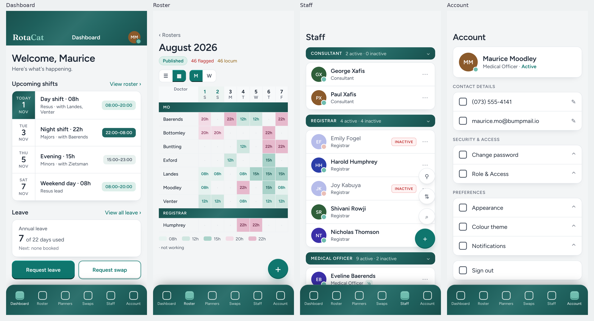
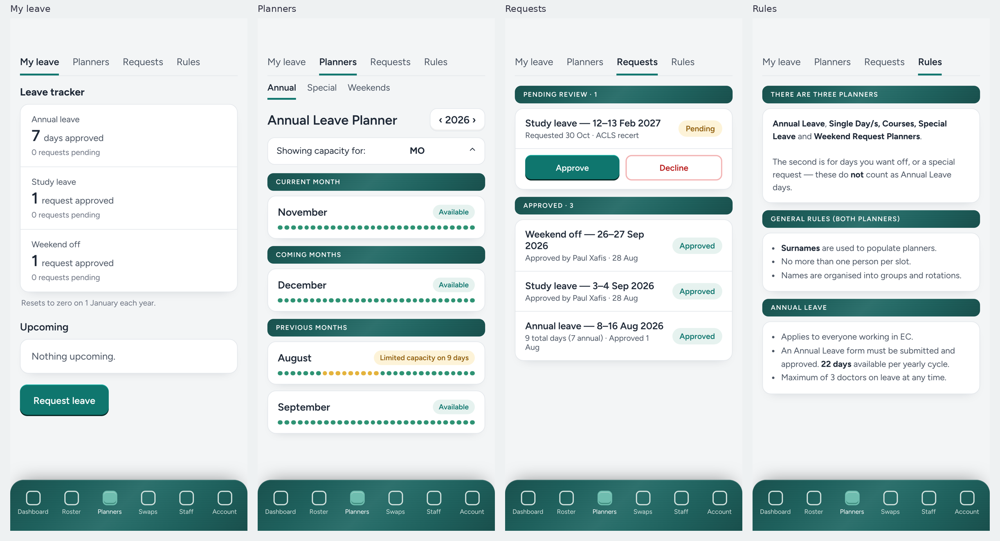
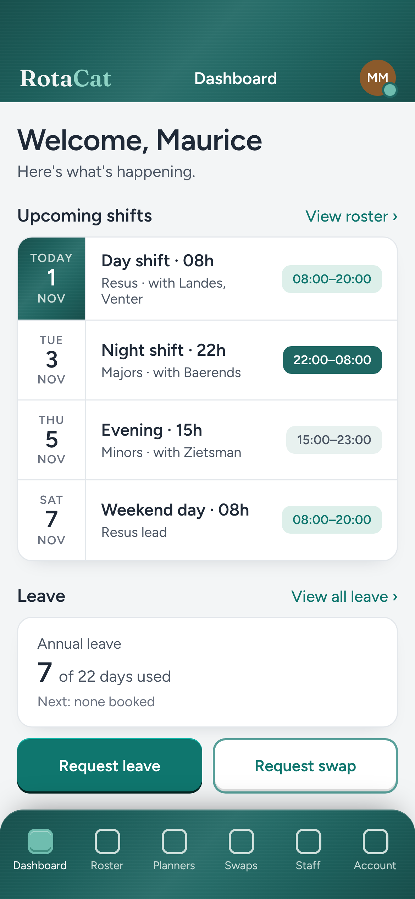

# RotaCat App Theme — Implementation Spec

Nov 1, 2026 (revised 7 Nov 2026: restrained sheen) · @Paul

Applies the login page's deep blue-green sheen and bevelled buttons across the mobile app. Companion to the Login spec; the login spec ships first.

## How to work

This is a re-theme, not a redesign. Every page keeps its current layout, spacing, navigation and copy; only surfaces, button treatment and a handful of text colours change. The one exception is the Dashboard's upcoming-shifts card, which has a new layout (below).

1. Ship the Login spec first (`docs/login-redesign/SPEC.md`). It defines the sheen CSS, the bevel and the tokens this spec reuses.
2. Inspect before editing: the layout shell (tab bar, Dashboard header), `src/styles/index.css`, `tailwind.config.js`, the Button component or `.btn` class from the Login spec, and each page named in Page-by-page.
3. Do not add a header bar to any page other than Dashboard. The other mobile pages start at the top on purpose to give calendars and grids the space.
4. Do not change: fonts, type sizes, page layouts, roster hour colours (08h–22h), `flag*` semantic colours, per-doctor avatar colours, the Inactive badge, the Danger Zone red.
5. Reuse the existing token system. Add tokens; do not hard-code hex in components.
6. Work in three commits: (a) shell — tab bar and Dashboard header; (b) Dashboard upcoming-shifts card; (c) group headers and category rows across Leave, Requests, Rules, Roster grid and Staff. Lint and build after each; test at 390 px and 1024 px.
7. Report: files changed, tokens added, every page touched, anything in this doc not done and why.

## The rule

Every surface in the app is one of four roles. Decide the role, then apply its tokens; never mix.

| Role | What it is | Treatment |
| --- | --- | --- |
| **Chrome** | Surfaces that frame the app and never hold data: the mobile tab bar, the Dashboard header | Sheen (`--bg-sheen` from the Login spec, same restrained values on every chrome and divider surface, on `#1F6763`). White text `#F3F6F5`; secondary `#CFE0DC`; mint accents `#8FD3C5`. The tab bar keeps its rounded top edge |
| **Divider** | Structural headers that group content but are not themselves content: Staff category headers, roster category rows (MO, REGISTRAR), planner section headers (CURRENT MONTH), Requests section headers (PENDING REVIEW), Rules section headers | Sheen, full-width bar, 10–12 px radius, white caps 11–12 px with `.06em` tracking, 8–9 px vertical padding. Counts and chevrons in `#CFE0DC`. A page may have many of these; that is intended |
| **Content** | Anything the user reads or taps into: cards, lists, grids, forms, inputs, the roster | White `#FFFFFF` on a `#F3F5F6` canvas, 14 px radius, 1 px `#E3E7EB` border, shadow `0 8px 18px -14px rgba(15,23,42,.25)`. Text unchanged |
| **Action** | Buttons and FABs | The Login spec's bevel rule: filled buttons have no border and take edges derived from their own fill (top +15%, bottom −18% lightness); outlined buttons keep their border with edges at +9% / −12% inside it. Teal on white, mint on sheen, red for destructive, green for approve. No drop shadows on buttons except FABs |

What is deliberately **not** sheen: page canvas, cards, list rows, inputs, chips, status pills, the Inactive badge, the Danger Zone, roster hour cells, planner capacity dots. If a surface holds a number someone will read, it is white.

The sheen is deliberately quiet: on a 40 px divider bar it reads as a slightly deeper teal with a soft top edge, nothing more. Do not raise the band or grain to make it "show" on small surfaces — the one value set from the Login spec is used everywhere, static, with no animation.

| Token | Value | Use |
| --- | --- | --- |
| `--color-canvas-app` | `#F3F5F6` | Page background behind cards |
| `--color-card` | `#FFFFFF` | Content surfaces |
| `--color-card-border` | `#E3E7EB` | Card hairline |
| `--bg-sheen` | Login spec, restrained values: corners 22%, band 6%, grain 2.5% | Chrome and dividers |
| `--color-on-sheen` | `#F3F6F5` | Primary text on sheen |
| `--color-on-sheen-2` | `#CFE0DC` | Secondary text, chevrons, counts on sheen |
| `--color-on-sheen-accent` | `#8FD3C5` | Wordmark "Cat", links on sheen |
| `--color-mint` | `#6FBDAF` | Active tab icon fill; status dot "active"; buttons placed on a sheen surface (dark ink `#0A100E`) |
| `--color-chip-mint` | `#E6F2EF` / `#0F766E` | Available / approved / day-shift chips |
| `--color-chip-night` | `#1F6763` / `#FFFFFF` | Night-shift time chip |
| `--color-chip-amber` | `#FDF3D8` / `#92600F` | Pending / limited-capacity chips |

The mint `#6FBDAF` appears only on sheen surfaces or as the active-tab indicator. On white, actions are teal `#0F766E`.

## Page by page

### Shell (every page)

- **Tab bar**: sheen, rounded top corners (22 px), `box-shadow: 0 -14px 30px -18px rgba(0,0,0,.5), inset 0 1px 0 rgba(255,255,255,.18)`. Labels `#CFE0DC`; active label white; active icon is a mint `#6FBDAF` filled square with the bevel. Icons themselves unchanged.
- **FABs** (Roster +, Staff +, Account page none): teal with the bevel; `box-shadow` adds `0 12px 24px -12px rgba(15,118,110,.6)` for lift off the canvas — the one place a button keeps an outer shadow, because it floats.
- **Canvas**: `#F3F5F6` on all pages. This is the only change to pages not listed below (Swaps, Hours Summary, Roster list): canvas, card and button tokens flow through; nothing else moves.

### Dashboard — redesigned

The only page with a header. Header becomes sheen: wordmark left ("Rota" `#F3F6F5`, "Cat" `#8FD3C5`), avatar right with the mint status dot, no page title. Height unchanged from current.

Upcoming shifts card, replacing the single-line empty state:

| Part | Spec |
| --- | --- |
| Rows | One per shift in the next 7 days; max 5; empty state keeps the current copy |
| Date cell | 64 px wide, left, separated by a 1 px border. Weekday caps 11 px `#6B7280`, day number 22 px semibold `#1F2937`, month caps 11 px. **Today's** date cell is sheen with white text |
| Middle | Line 1: shift name + hour code, 16 px semibold ("Day shift · 08h"). Line 2: area and co-workers, 13 px `#4B5563` ("Resus · with Landes, Venter") |
| Right | Time chip, 12 px semibold: day/weekend `--color-chip-mint`; night `--color-chip-night`; evening `#E8F1EF` / `#4B5563` |
| Leave card | Replaces "No leave booked". Label, big number with "of 22 days used", next booked date or "Next: none booked" |
| Quick actions | Two-up row: **Request leave** (primary bevel) and **Request swap** (secondary) |

Data: upcoming shifts come from the published roster for the signed-in doctor; co-workers are the other names in the same slot. If the roster for the window is unpublished, show the empty state.

### Leave — My leave

No structural change. Tracker cards and Upcoming card take the content tokens; Request leave takes the bevel. The "Resets to zero" note stays `#6B7280`.

### Leave — Planners (Annual, Special, Weekends)

Section headers **CURRENT MONTH / COMING MONTHS / PREVIOUS MONTHS** become sheen dividers. Month cards unchanged (white, name, status pill, capacity dots). The year stepper and the capacity selector take the soft secondary bevel. Capacity dot colours (green / amber) unchanged — they are semantic. The Weekend planner's "Request weekend off" button takes the primary bevel; its surrounding pale-mint panel stays as is.

### Leave — Requests

**PENDING REVIEW / APPROVED** become sheen dividers with the count appended ("PENDING REVIEW · 1"). Request rows unchanged. Status pills: Approved `--color-chip-mint`, Pending `--color-chip-amber`. For reviewers, the Approve / Decline pair under a pending request: Approve = green filled (`#4F9E6F` day / `#6BAF80` night), bevel derived from the green; Decline = outlined red (`#D14343` border day, `#D98C7F` night), bevel derived from its fill inside the border. Neither uses white or black edge overlays.

### Leave — Rules

Each section title (**THERE ARE THREE PLANNERS**, **GENERAL RULES**, **ANNUAL LEAVE**, …) becomes a sheen divider; the body text sits in a white card below it. Text unchanged. This is the longest page and will show the most sheen bars; that is accepted.

### Roster — grid

Category rows (**MO**, **REGISTRAR**, **EC INTERN**, …) become sheen dividers spanning the full grid width. Hour cells keep their current colours exactly. Header row: pale `#F7F9FA`, weekend columns `#EDF4F2` with teal day numbers. The view toggles (list/grid, M/W) take the bevel on their active segment.

### Staff

Category headers (**CONSULTANT 2 active · 0 inactive**, …) become sheen dividers; counts in `#CFE0DC`, chevron `#CFE0DC`. Person rows unchanged: avatar colours, Inactive badge, kebab. Status dot: active = mint `#6FBDAF`; inactive = current salmon. The ½ and OT·Psych sub-chips take `--color-chip-mint`. Tool buttons (filter, sort, search) are white circles with a soft bevel; the add FAB is teal bevel.

### Account

No structural change. Cards take content tokens; chevrons `#6B7280`. The profile card's status word "Active" stays teal. Sign out stays a plain row. Danger Zone keeps its red card and red text; no bevel, no sheen.

## Dark mode

Same four roles; the content role darkens and the sheen base shifts to the tint derived from the dark-mode button colour.

| Token | Light | Dark |
| --- | --- | --- |
| `--color-canvas-app` | `#F3F5F6` | `#0A100E` |
| `--color-card` | `#FFFFFF` | `#1B3B35` |
| `--color-card-border` | `#E3E7EB` | `rgba(111,189,175,.22)` |
| `--bg-sheen` base | `#1F6763` | `#1B3B35`, highlight layer at 4% (not 6%) |
| Primary button | `#0F766E` / white text | `#6FBDAF` / `#0A100E` text |
| Body text | `#1F2937` / `#4B5563` | `#F3F6F5` / `#A9B8B4` |
| Chip mint | `#E6F2EF` / `#0F766E` | `rgba(111,189,175,.18)` / `#8FD3C5` |
| Chip night | `#1F6763` / white | `#6FBDAF` / `#0A100E` (inverts, so night still reads as the strong chip) |
| Inputs | white, `accent/70` border | `#142320`, `#5A897F` border |

Semantic colours (`flag*`, roster hour palette, avatar colours, Inactive, Danger) do not change between modes; check their contrast on `#1B3B35` and lift only the ones that fail.

## Verification before merge

- [ ] `npm run lint` and `npm run build` clean after each of the three commits
- [ ] Only the Dashboard has a header; Leave, Roster, Staff, Account, Swaps start at the top as before
- [ ] Tab bar: sheen, rounded top, active icon mint bevel, on every page
- [ ] Dashboard upcoming-shifts card: today's date cell sheen; night chip dark; empty state unchanged when no roster
- [ ] Every button in the app shows the bevel; FABs keep their lift shadow; nothing else has a drop shadow
- [ ] Sheen dividers: Staff category headers, roster category rows, planner section headers, Requests section headers, Rules section headers — and nowhere else
- [ ] No roster hour cell, capacity dot, flag colour, avatar colour or Danger Zone colour has changed (visual diff against current)
- [ ] Text on sheen ≥ 4.5:1: `#F3F6F5` and `#CFE0DC` on `#1F6763` both pass; verify after any base-colour tweak
- [ ] Dark mode: cards `#1B3B35`, sheen softened, semantic colours checked for contrast
- [ ] 390 px and 1024 px screenshots of all eight pages attached to the PR
