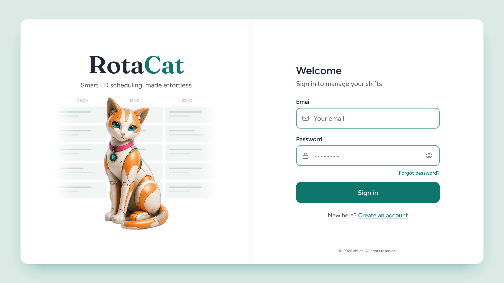
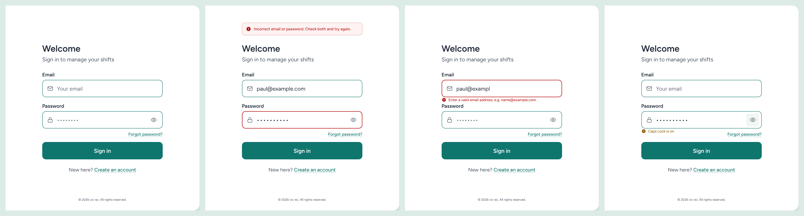

# RotaCat Login — Implementation Spec

Oct 31, 2026 · Paul Xafis

## How to work

This doc is the complete brief for rebuilding `/login` in `vic-ec/RotaCat`. Follow it without this chat.

1. Inspect before editing: `src/pages/LoginPage.jsx`, `AuthHero.jsx`, `MobileAuthHero.jsx`, `PasswordRevealToggle.jsx`, `CapsLockNotice.jsx`, `AuthFooter.jsx`, `src/styles/index.css`, `tailwind.config.js`, `index.html`, and `package.json` (React version decides the `inert` syntax).
2. Reuse the existing token system (`--color-*` in `index.css`, mapped in `tailwind.config.js`). Add tokens; do not hard-code hex in components.
3. No new dependencies, UI libraries or animation libraries.
4. Do not change: fonts, font sizes, font colours (except where the Accessibility table says so), the mascot image and its treatment, the decorative roster grid and its time labels, the password visibility toggle's icon and behaviour, authentication logic, validation rules, routes, Turnstile.
5. One `SignInForm` component, mounted inline on desktop and inside the existing modal on mobile.
6. Run lint and build; test desktop (1024, 1440) and mobile (390) before reporting. Finish with: files changed, tokens added, anything from this doc not done and why.

## Decisions

The login page moves to a light two-tone card with the sign-in form shown inline on desktop. No dark teal and no mint behind the form.

| Decision | Choice | Why |
| --- | --- | --- |
| Page background | Light mint `#DCEBE6` | Replaces the dark teal `#0F766E` full-page background |
| Brand half (wordmark, mascot, grid) | White `#FFFFFF` (theme C) | Both halves white; the light-mint page carries the brand colour |
| Login half | White `#FFFFFF`, flush against the brand half | Highest contrast for the form; the two halves share one shell |
| Desktop form | Inline at `lg:` (1024 px+); modal kept for mobile | Saves a click per login and removes the modal focus-trap problem on desktop |
| Text links | Teal `#0F766E` for "Forgot password?" and "Create an account" | Rose `#D6577E` on white is 3.80:1 and fails AA; teal on white is 5.47:1. Rose stays a brand accent (mascot collar), not a UI colour |
| Email placeholder | `Your email` | Neutral; no organisation domain |
| Fonts, sizes, font colours | Unchanged from live | Fraunces wordmark, Figtree body, `#1F2937` / `#4B5563` ink |
| Decorative roster grid | Unchanged | Decorative, `aria-hidden`; time labels stay faint |

## Visual spec

One raised shell, two flush white halves, a 1 px seam, on a light-mint page. Theme C, approved 31 Oct.

| Token | Value | Use |
| --- | --- | --- |
| `--color-canvas` | `#DCEBE6` | Page background (light mint) |
| `--color-panel` | `#FFFFFF` | Both halves |
| `--color-seam` | `#DDE4E2` | 1 px divider; plus `box-shadow: inset -10px 0 14px -14px rgba(15,23,42,.14)` on the brand half's right edge |
| `--color-shell-border` | `#E3E7EB` | 1 px hairline round the shell |
| `--color-grid-cell` | `#F1F5F4` | Decorative roster cells |
| `--color-grid-bar` | `#CBD9D5` / `#E0E8E5` | Bars inside cells (primary / secondary) |
| Shell radius | 24 px | Outer corners only; halves square |
| Shell shadow | `0 28px 56px -26px rgba(15,118,110,.45), 0 2px 6px rgba(15,23,42,.06), inset 0 1px 0 rgba(255,255,255,.95)` | One shadow on the shell, none on the halves |
| Shell inset | 60 px top/bottom, 64 px sides at 1600 px | Scale with viewport; halves stay 50/50 |
| Form width | 456 px, centred in the login half | Heading, fields, button and links share this width |
| Input border | `#0F766E` at 70% (`border-accent/70`), 2 px, 14 px radius | 3.07:1 on white; was 50% |
| Input focus | solid `#0F766E` 2 px outline, 2 px offset | Was `accent/25` |
| Primary button | `#0F766E`, white text, 14 px radius, 66 px tall | Unchanged colour |
| Links | `#0F766E`, underlined, `underline-offset-4`, decoration at 45% | "Forgot password?" (right-aligned under Password) and "Create an account" |
| Footer | `#4B5563`, 12 px, bottom of the login half | Was `#6B7280` at 10 px |

What does not change: Fraunces 600 wordmark with teal "Cat"; Figtree body; `#1F2937` headings; `#4B5563` secondary text; the mascot image, scale and position; the roster grid and its 45%-opacity time labels.

The seam is subtle by design. If it disappears on a ward monitor, widen it to 2 px before adding any colour; do not reintroduce a mint or grey half.

## Mobile

The mobile layout (below 1024 px) keeps its current structure: hero on top, bottom sheet with the Welcome button, sign-in form in the existing modal. Only these change:

- Token changes flow through: `Your email` placeholder, teal underlined links, `accent/70` borders, solid focus ring, `#92600F` Caps Lock, footer `#4B5563` 12 px.
- P1-1 (`inert`, `role="dialog"`), P2-3 (`min-h-dvh` / `min-h-[44dvh]`), P3-1 (toggle hit area), P3-2 (link order) apply inside the modal.
- The modal form must also hold field positions: the credential banner sits above the modal title, inline messages in the gap below their field, exactly as on desktop.

Optional, not required: the bottom sheet is currently mint `#C7E8E0`. For consistency with theme C it could become white on a `#DCEBE6` page with the same seam treatment along its top edge. Leave it unless time allows.

## SignInForm component

One component, two mounts. State that belongs to the form stays in it; state the page owns is passed down.

| Owned by `SignInForm` | Passed from `LoginPage` |
| --- | --- |
| Email and password values, validity, `emailInvalid` | `onSubmit(email, password)` |
| Reveal state (via the existing `PasswordRevealToggle`) | `error` (credential banner text or null) |
| Caps Lock state (existing `CapsLockNotice`) | `submitting`, `verifying` (Turnstile) |
| Field refs for focus-on-error | `onForgotPassword()` |
| Local ids: `email`, `password`, `email-error`, `verify-status` | `variant: 'inline' \| 'modal'` (only affects the heading element and the banner's anchor) |

Desktop (`lg:` and up): `<SignInForm variant="inline" />` in the login half; the Welcome heading and subtitle are part of the form. Below `lg:`: the existing Welcome button opens the modal, which mounts `<SignInForm variant="modal" />`. The Forgot-password modal is unchanged apart from P1-1.

## Accessibility fixes to implement

Nine changes, roughly three hours. P1 first; the inline desktop form makes P1-1 a mobile-only fix.

| # | Fix | Files | Change | WCAG |
| --- | --- | --- | --- | --- |
| P1-1 | Keep hidden modals out of the tab order; mark the open one as a dialog | `SignInModal`, `ForgotPasswordModal`, `LoginPage.jsx` | Replace `aria-hidden={!isOpen}` with `{...(!isOpen && { inert: '' })}` on the wrapper (React 18 string; boolean in React 19). Add `role="dialog" aria-modal="true" aria-labelledby="signin-title"` on the panel; title becomes `<h2 id="signin-title">`. Set `inert` on the page wrappers while a modal is open. Re-test 1Password, Bitwarden, Chrome and iOS autofill afterwards | 2.4.3, 2.4.7, 4.1.2 |
| P1-2 | Allow pinch-zoom | `index.html` | Remove `maximum-scale=1.0` from the viewport meta. Inputs are already 16 px | 1.4.4 |
| P1-3 | Contrast | `index.css`, `tailwind.config.js`, form components | Links `text-accent underline`; input border `border-accent/70`; error border `border-flagRed` (solid); focus `focus-visible:outline-accent`; add `--color-flagAmber-text: 146 96 15` (`#92600F`) for the Caps Lock notice. Footer `text-xs text-ink-light`. The four mint-panel failures disappear with the white login half | 1.4.3, 1.4.11 |
| P2-1 | Announce errors | Email/password field component, `LoginPage.jsx` | `aria-describedby="email-error"` when invalid; error `
` with an icon at `text-sm`. Banner wrapper always mounted: `
`. On credential failure set `aria-invalid` on both fields and focus + select the password | 3.3.1, 4.1.2, 4.1.3 |
| P2-2 | Explain the Turnstile wait | `LoginPage.jsx` | `aria-disabled` instead of `disabled`; `aria-describedby="verify-status"`; `
Checking your connection is secure…
`; `aria-busy={submitting}` on the form; spinner keeps button width | 4.1.3 |
| P2-3 | Stop mobile sheet clipping at 200% text | `LoginPage.jsx` | `h-dvh` → `min-h-dvh`; `h-[44dvh]` → `min-h-[44dvh]` | 1.4.4, 1.4.10 |
| P3-1 | Enlarge the eye toggle | `PasswordRevealToggle.jsx` | `absolute right-1.5 top-1/2 -translate-y-1/2 flex h-10 w-10 items-center justify-center rounded-md`; add `aria-pressed={revealed}` and `aria-controls="password"`. Keep `pr-12` on the input. Icon and behaviour unchanged | 2.5.8 |
| P3-2 | Focus order | Form component | Move "Forgot password?" below the password field, right-aligned: Email → Password → Show → Forgot → Sign in | 2.4.3 |
| P3-3 | Headings | `LoginPage.jsx`, modals | "Welcome" `
` → `<h2>`; modal titles → `<h2 id=…>` | 1.3.1, 2.4.6 |
| P4-1 | Inline form on desktop | `LoginPage.jsx`, new `SignInForm.jsx` | Render `<SignInForm />` in the login half at `lg:`; keep the Welcome button + modal below `lg:`. One component, two mounts | — |

Also fix `text-[18.9 px]` → `text-lg` if the space is present in the class (reported, not verified here).

**Fixed field positions.** No state may move the Email field, Password field or Sign in button. The credential-error banner is absolutely positioned above the "Welcome" heading (`position:absolute; bottom:100%; margin-bottom:30px` on a wrapper inside the relatively positioned form), so it occupies no layout space. Inline field messages (email invalid, Caps Lock) render inside the existing 22 px gap below their field as zero-height elements (`height:0; overflow:visible`, `translateY(6px)`, 14 px). Verified against four states in the image below.

## Deferred or dropped from the audit

| Item | Status | Reason |
| --- | --- | --- |
| P2-4 height-aware `split` breakpoint (landscape phones) | Deferred | Real issue at 844×390, but it changes every breakpoint gate. Solve it with the inline-form work, after P1–P3 ship |
| P3-4 named type-scale tokens | Deferred | Housekeeping; not blocking. The `text-[18.9 px]` one-liner is in scope |
| P4-2 enlarge mascot 10–15% | Dropped | Tied to the old layout; in the flush two-tone design the mascot already fills the brand half |
| P4-5 passkeys | Dropped (roadmap) | Not a login-page redesign item |
| `rose-deep #9D2F5A` token | Dropped | Not needed once links are teal; rose stays a non-text accent |
| Dark-theme findings | Noted | The `border-accent/70` change covers the one dark-theme failure if a dark theme ships |
| Audit scorecard weights | Ignored | Useful narrative, not a measurement |

## States to design and test

Every audit failure lives in a non-default state. Four states are shown in the image under Fixed field positions; the rest follow the same tokens. Each state gets a manual check.

| State | Trigger | What must be visible |
| --- | --- | --- |
| Default | Page load, desktop | Inline form, `Your email` placeholder, teal links |
| Focus | Tab to email | Solid teal 2 px outline with offset; `accent/70` border on the unfocused field |
| Email invalid | Blur with bad address | Solid red border, red `text-sm` message with icon, `aria-describedby` wired |
| Credential error | Wrong password | `role="alert"` banner above the "Welcome" heading (no layout shift); both fields `aria-invalid`; focus in password |
| Turnstile wait | Before token arrives | Button `aria-disabled` at 70% teal; status line "Checking your connection is secure…" |
| Loading | After submit | Spinner + "Signing in…" inside the button; width unchanged |
| Caps Lock | Caps on in password | Amber `#92600F` notice with icon under the field |
| 200% text | Browser zoom / OS text size | No clipping; mobile sheet grows; page scrolls |

## Verification before merge

- [ ] `npm run lint` and `npm run build` clean
- [ ] Keyboard-only pass on desktop: Tab never lands on an invisible control; order Email → Password → Show → Forgot → Sign in → Create an account
- [ ] Keyboard-only pass on mobile: focus stays inside the open modal; Escape closes and returns focus
- [ ] axe DevTools: zero contrast or ARIA violations on the login route
- [ ] VoiceOver (iOS) and NVDA or Narrator (Windows): email error and credential banner are announced
- [ ] Password managers after `inert`: 1Password, Bitwarden, Chrome, iOS Keychain all fill both fields
- [ ] 200% text at 390 px: nothing clipped, page scrolls
- [ ] Pinch-zoom works on Android Chrome
- [ ] 768 px: "Create an account" on one line
- [ ] Eye toggle: 40×40 px hit area, icon unchanged, state announced
- [ ] Visual diff against the target image in Visual spec: fonts, sizes and font colours unchanged; mascot and grid unchanged
