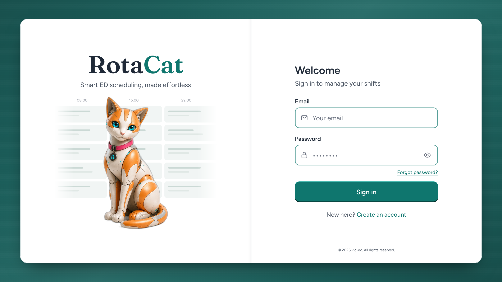
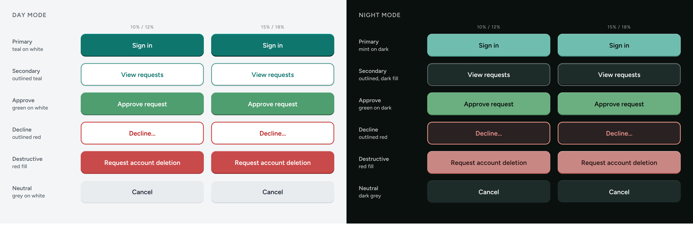
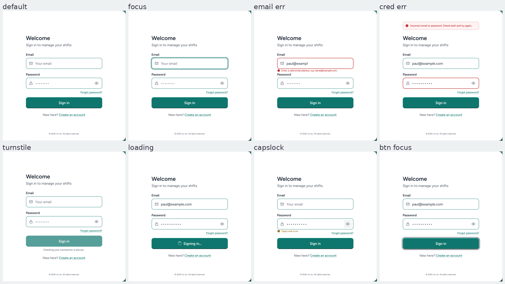

# RotaCat Login — Implementation Spec

Oct 31, 2026 (revised 7 Nov 2026: buttons v2, restrained sheen) · Paul Xafis

## How to work

This doc is the complete brief for rebuilding `/login` in `vic-ec/RotaCat`. Follow it without this chat.

1. Inspect before editing: `src/pages/LoginPage.jsx`, `AuthHero.jsx`, `MobileAuthHero.jsx`, `PasswordRevealToggle.jsx`, `CapsLockNotice.jsx`, `AuthFooter.jsx`, `src/styles/index.css`, `tailwind.config.js`, `index.html`, and `package.json` (React version decides the `inert` syntax).
2. Reuse the existing token system (`--color-*` in `index.css`, mapped in `tailwind.config.js`). Add tokens; do not hard-code hex in components.
3. No new dependencies, UI libraries or animation libraries.
4. Do not change: fonts, font sizes, font colours (except where the Accessibility table says so), the mascot image and its treatment, the decorative roster grid and its time labels, the password visibility toggle's icon and behaviour, authentication logic, validation rules, routes, Turnstile. Button sizes, radii and labels stay as they are; only the surface treatment changes.
5. One `SignInForm` component, mounted inline on desktop and inside the existing modal on mobile.
6. Work in two commits: (a) login page and tokens, (b) app-wide button treatment. Run lint and build after each; test desktop (1024, 1440) and mobile (390) before reporting. Finish with: files changed, tokens added, every button location touched, anything from this doc not done and why.

## Decisions

The login page becomes a white two-half card on a deep blue-green page with a brushed-metal sheen, the sign-in form inline on desktop, and a bevelled button treatment applied to every button in the app. Decided 1 Nov 2026; supersedes the theme C / light-mint decision of 31 Oct.

| Decision | Choice | Why |
| --- | --- | --- |
| Page background | Blue-green 6 `#1F6763` with sheen | Deep enough that the white card is the only light object; hue still reads on a weak monitor; same hue family as the app's teal |
| Sheen | Restrained corner-dark diagonal (22%), faint highlight band (6%), near-invisible 1 px grain (2.5%) | Brushed-metal satin, not gloss. Pure CSS, no image |
| Brand half and login half | Both white `#FFFFFF`, flush, 1 px seam | The card is the spotlight; the page carries the colour |
| Desktop form | Inline at `lg:` (1024 px+); modal kept for mobile | Saves a click per login and removes the modal focus-trap problem on desktop |
| Buttons (app-wide) | Inset bevel derived from each button's own fill (+15% top, −18% bottom); no border on filled buttons; no drop shadow | Reads as a physical key against the brushed page; applies to every button, mobile and desktop |
| Text links | Teal `#0F766E` for "Forgot password?" and "Create an account" | Rose `#D6577E` on white is 3.80:1 and fails AA; teal on white is 5.47:1. Rose stays a brand accent, not a UI colour |
| Email placeholder | `Your email` | Neutral; no organisation domain |
| Mobile sheet | Sheen, keeping the rounded top edge | The sheet is the one mobile surface with no wordmark, so it can carry the deep colour; see Mobile |
| Fonts, sizes, font colours | Unchanged from live | Fraunces wordmark, Figtree body, `#1F2937` / `#4B5563` ink |
| Decorative roster grid | Unchanged | Decorative, `aria-hidden`; time labels at 60% opacity (was 45%) |

## Visual spec

One raised white card, two flush halves, a 1 px seam, on a deep blue-green brushed-metal page. Approved 1 Nov.



| Token | Value | Use |
| --- | --- | --- |
| `--color-canvas` | `#1F6763` | Page base colour (Blue-green 6) |
| `--bg-canvas-sheen` | see CSS block below | Page background: the sheen layers over `--color-canvas`. Apply to the auth page wrapper on desktop and mobile |
| `--color-panel` | `#FFFFFF` | Both halves of the card; the mobile sheet |
| `--color-seam` | `#DDE4E2` | 1 px divider; plus `box-shadow: inset -10px 0 14px -14px rgba(15,23,42,.14)` on the brand half's right edge |
| `--color-shell-border` | `#E3E7EB` | 1 px hairline round the card |
| `--color-grid-cell` | `#F1F5F4` | Decorative roster cells |
| `--color-grid-bar` | `#CBD9D5` / `#E0E8E5` | Bars inside cells (primary / secondary) |
| Card radius | 24 px | Outer corners only; halves square |
| Card shadow | `0 30px 60px -26px rgba(0,0,0,.6), 0 2px 6px rgba(15,23,42,.10), inset 0 1px 0 rgba(255,255,255,.95)` | Near-black so the card separates from the deep page |
| Card inset | 60 px top/bottom, 64 px sides at 1600 px | Scale with viewport; halves stay 50/50 |
| Form width | 456 px, centred in the login half | Heading, fields, button and links share this width |
| Input border | `#0F766E` at 70% (`border-accent/70`), 2 px, 14 px radius | 3.07:1 on white; was 50% |
| Input focus | solid `#0F766E` 2 px outline, 2 px offset | Was `accent/25` |
| Links | `#0F766E`, underlined, `underline-offset-4`, decoration at 45% | "Forgot password?" (right-aligned under Password) and "Create an account" |
| Footer | `#4B5563`, 12 px, bottom of the login half | Was `#6B7280` at 10 px |

Page background CSS (two layers over the base colour; keep the order):

```css
.auth-page {
  background:
    linear-gradient(135deg,
      rgba(0,0,0,.22) 0%, rgba(0,0,0,.08) 24%,
      rgba(255,255,255,.06) 48%, rgba(255,255,255,.03) 56%,
      rgba(0,0,0,.08) 76%, rgba(0,0,0,.24) 100%),
    repeating-linear-gradient(0deg,
      rgba(255,255,255,.025) 0 1px, rgba(0,0,0,.01) 1px 2px, transparent 2px 3px),
    #1F6763;
}
```

Layer 1 darkens the top-left and bottom-right corners (22–24%) and puts a faint highlight band (6%) on the bottom-left to top-right diagonal — restrained on purpose: the page should read as a deep satin teal, not as a lit surface. Layer 2 is a brushed grain at 2.5%, below the threshold where scan lines show at 100% zoom. If a ward monitor still shows banding in the margins, remove layer 2 and keep the rest. The sheen is static; no motion, no parallax.

What does not change: Fraunces 600 wordmark with teal "Cat"; Figtree body; `#1F2937` headings; `#4B5563` secondary text; the mascot image, scale and position; the roster grid. Its time labels lift one step from 45% to 60% opacity (#6B7280 at .6) so they read on a ward monitor; nothing else in the grid changes.

The seam is subtle by design. If it disappears on a ward monitor, widen it to 2 px before adding any colour. Do not add a mint or grey half, and do not lighten the page to compensate.

## Button system (app-wide)

Every button in RotaCat, on every page and at every breakpoint, takes the same inset bevel. The bevel is **derived from the button's own fill colour**, never from fixed white or black overlays, and filled buttons have **no border**. One helper, applied everywhere; no per-page overrides. Revised 1 Nov after review of the first build.



**The rule**

| Button kind | Border | Top edge (1 px) | Bottom edge (2 px) |
| --- | --- | --- | --- |
| Filled (primary, approve, destructive, neutral, mint-on-sheen) | None | Fill lightened **15%** (HSL lightness) | Fill darkened **18%** |
| Outlined (secondary, decline) | Keeps its existing 2 px border | Fill lightened **9%**, drawn inside the border | Fill darkened **12%**, drawn inside the border |
| Icon-only (password eye, kebab, chevrons) | — | No bevel | No bevel |
| Disabled / `aria-disabled` | as its kind | `opacity: .6; box-shadow: none` — flat | — |
| Active (pressed) | as its kind | Edges swap: dark 2 px on top, light 1 px below | — |
| Focus-visible | as its kind | Existing solid outline, 2 px, 3 px offset; bevel unchanged | — |
| FABs | None | As filled | As filled, plus the lift shadow `0 12px 24px -12px rgba(15,118,110,.6)` — the only buttons with an outer shadow |

```css
/* index.css — the helper. --btn-bg is the fill; edges derive from it. */
.btn {
  --btn-bg: #0F766E;
  --btn-up: 15%;
  --btn-dn: 18%;
  background: var(--btn-bg);
  border: 0;
  box-shadow:
    inset 0 1px 0 hsl(from var(--btn-bg) h s calc(l + var(--btn-up))),
    inset 0 -2px 0 hsl(from var(--btn-bg) h s calc(l - var(--btn-dn)));
}
.btn-outlined { --btn-up: 9%; --btn-dn: 12%; border: 2px solid var(--btn-border); }
.btn:active { box-shadow:
    inset 0 2px 0 hsl(from var(--btn-bg) h s calc(l - var(--btn-dn))),
    inset 0 -1px 0 hsl(from var(--btn-bg) h s calc(l + var(--btn-up))); }
.btn[aria-disabled="true"], .btn:disabled { opacity: .6; box-shadow: none; }
```

Relative colour syntax (`hsl(from …)`) is supported in Chrome 119+, Safari 16.4+, Firefox 128+. If the project's browserslist is older, precompute the two edge colours per variant with the values below and set them as `--btn-up-c` / `--btn-dn-c` tokens instead.

**Precomputed edges at 15% / 18%**

| Variant | Fill | Top edge | Bottom edge | Text |
| --- | --- | --- | --- | --- |
| Primary (day) | `#0F766E` | `#18BAAD` | `#052522` | `#FFFFFF` |
| Primary (night) / mint on sheen | `#6FBDAF` | `#A3D5CC` | `#418F81` | `#0A100E` |
| Approve (day) | `#4F9E6F` | `#7CBE97` | `#306144` | `#FFFFFF` |
| Approve (night) | `#6BAF80` | `#9DCAAB` | `#437B54` | `#0A100E` |
| Destructive (day) | `#C94A4A` | `#DB8585` | `#8D2A2A` | `#FFFFFF` |
| Destructive (night) | `#C98784` | `#E0BBB9` | `#A84E4A` | `#2B1716` |
| Neutral (day) | `#E9ECEF` | `#FFFFFF` | `#B4BEC8` | `#1F2937` |
| Neutral / dark fill (night) | `#1E2C29` | `#3D5953` | `#000000` | `#F3F6F5` |

**Outlined at 9% / 12%**

| Variant | Fill | Border | Top edge | Bottom edge | Text |
| --- | --- | --- | --- | --- | --- |
| Secondary (day) | `#FFFFFF` | `rgba(15,118,110,.7)` | `#FFFFFF` (clamped) | `#E0E0E0` | `#0F766E` |
| Secondary (night) | `#1E2C29` | `rgba(255,255,255,.28)` | `#30453F` | `#0B100F` | `#F3F6F5` |
| Decline (day) | `#FFFFFF` | `#D14343` | `#FFFFFF` (clamped) | `#EBEBEB` | `#B91C1C` |
| Decline (night) | `#2A2222` | `#D98C7F` | `#3A2F2F` | `#1A1515` | `#E8908C` |

Hover: fill one step darker (day) or lighter (night); edges re-derive automatically. A white outlined button shows only its bottom edge, since white cannot lighten — that is correct. When a fill is darker than `#1E2C29` the bottom edge clamps at black; keep the top edge and accept it.

Implementation notes: put the helper on a `.btn` base class (or the existing Button component). Remove every per-button `border` on filled buttons and every `shadow-*` utility on any button. Where a button already has a `box-shadow` for another reason, the bevel wins. In scope: mobile Welcome "Sign in", modal submits, Approve/Decline pairs, Request leave / Request weekend off, roster and planner toolbar buttons, account-page buttons including "Request account deletion", all FABs. Audit with `grep -rn "<button" src` and `grep -rn "shadow-" src | grep -i button`.

## Mobile

The mobile layout (below 1024 px) keeps its structure: hero on top, bottom sheet with the Welcome button, sign-in form in the existing modal. These change:

- Token changes flow through: `Your email` placeholder, teal underlined links, `accent/70` borders, solid focus ring, `#92600F` Caps Lock, footer `#4B5563` 12 px.
- P1-1 (`inert`, `role="dialog"`), P2-3 (`min-h-dvh` / `min-h-[44dvh]`), P3-1 (toggle hit area), P3-2 (link order) apply inside the modal.
- The modal form must also hold field positions: the credential banner sits above the modal title, inline messages in the gap below their field, exactly as on desktop.

Required, not optional: the bottom sheet changes from mint `#C7E8E0` to the **sheen** (`--bg-canvas-sheen` on `#1F6763`), keeping its rounded top edge exactly as now. The page behind the hero stays white; the hero (wordmark, mascot, grid) is unchanged, so no text-colour question arises. On the sheet: heading `#F3F6F5`, subtitle `#CFE0DC`, links `#8FD3C5` underlined, "Sign in" is the mint-on-sheen filled button (`#6FBDAF`, ink `#0A100E`, bevel). The sign-in modal stays white in day mode and `#1B3B35` in night mode. Decided 1 Nov; supersedes the earlier white-sheet note.

## SignInForm component

One component, two mounts. State that belongs to the form stays in it; state the page owns is passed down.

| Owned by `SignInForm` | Passed from `LoginPage` |
| --- | --- |
| Email and password values, validity, `emailInvalid` | `onSubmit(email, password)` |
| Reveal state (via the existing `PasswordRevealToggle`) | `error` (credential banner text or null) |
| Caps Lock state (existing `CapsLockNotice`) | `submitting`, `verifying` (Turnstile) |
| Field refs for focus-on-error | `onForgotPassword()` |
| Local ids: `email`, `password`, `email-error`, `verify-status` | `variant: 'inline' \| 'modal'` (only affects the heading element and the banner's anchor) |

Desktop (`lg:` and up): `<SignInForm variant="inline" />` in the login half; the Welcome heading and subtitle are part of the form. Below `lg:`: the existing Welcome button opens the modal, which mounts `<SignInForm variant="modal" />`. The Forgot-password modal is unchanged apart from P1-1.

## Accessibility fixes to implement

Nine changes, roughly three hours. P1 first; the inline desktop form makes P1-1 a mobile-only fix.

| # | Fix | Files | Change | WCAG |
| --- | --- | --- | --- | --- |
| P1-1 | Keep hidden modals out of the tab order; mark the open one as a dialog | `SignInModal`, `ForgotPasswordModal`, `LoginPage.jsx` | Replace `aria-hidden={!isOpen}` with `{...(!isOpen && { inert: '' })}` on the wrapper (React 18 string; boolean in React 19). Add `role="dialog" aria-modal="true" aria-labelledby="signin-title"` on the panel; title becomes `<h2 id="signin-title">`. Set `inert` on the page wrappers while a modal is open. Re-test 1Password, Bitwarden, Chrome and iOS autofill afterwards | 2.4.3, 2.4.7, 4.1.2 |
| P1-2 | Allow pinch-zoom | `index.html` | Remove `maximum-scale=1.0` from the viewport meta. Inputs are already 16 px | 1.4.4 |
| P1-3 | Contrast | `index.css`, `tailwind.config.js`, form components | Links `text-accent underline`; input border `border-accent/70`; error border `border-flagRed` (solid); focus `focus-visible:outline-accent`; add `--color-flagAmber-text: 146 96 15` (`#92600F`) for the Caps Lock notice. Footer `text-xs text-ink-light`. The four mint-panel failures disappear with the white login half | 1.4.3, 1.4.11 |
| P2-1 | Announce errors | Email/password field component, `LoginPage.jsx` | `aria-describedby="email-error"` when invalid; error `<p id="email-error">` with an icon at `text-sm`. Banner wrapper always mounted: `<div role="alert" aria-live="assertive" className="empty:hidden">`. On credential failure set `aria-invalid` on both fields and focus + select the password | 3.3.1, 4.1.2, 4.1.3 |
| P2-2 | Explain the Turnstile wait | `LoginPage.jsx` | `aria-disabled` instead of `disabled`; `aria-describedby="verify-status"`; `<p id="verify-status" role="status">Checking your connection is secure…</p>`; `aria-busy={submitting}` on the form; spinner keeps button width | 4.1.3 |
| P2-3 | Stop mobile sheet clipping at 200% text | `LoginPage.jsx` | `h-dvh` → `min-h-dvh`; `h-[44dvh]` → `min-h-[44dvh]` | 1.4.4, 1.4.10 |
| P3-1 | Enlarge the eye toggle | `PasswordRevealToggle.jsx` | `absolute right-1.5 top-1/2 -translate-y-1/2 flex h-10 w-10 items-center justify-center rounded-md`; add `aria-pressed={revealed}` and `aria-controls="password"`. Keep `pr-12` on the input. Icon and behaviour unchanged | 2.5.8 |
| P3-2 | Focus order | Form component | Move "Forgot password?" below the password field, right-aligned: Email → Password → Show → Forgot → Sign in | 2.4.3 |
| P3-3 | Headings | `LoginPage.jsx`, modals | "Welcome" `<p>` → `<h2>`; modal titles → `<h2 id=…>` | 1.3.1, 2.4.6 |
| P4-1 | Inline form on desktop | `LoginPage.jsx`, new `SignInForm.jsx` | Render `<SignInForm />` in the login half at `lg:`; keep the Welcome button + modal below `lg:`. One component, two mounts | — |

Also fix `text-[18.9 px]` → `text-lg` if the space is present in the class (reported, not verified here).

**Fixed field positions.** No state may move the Email field, Password field or Sign in button. The credential-error banner is absolutely positioned above the "Welcome" heading (`position:absolute; bottom:100%; margin-bottom:30px` on a wrapper inside the relatively positioned form), so it occupies no layout space. Inline field messages (email invalid, Caps Lock) render inside the existing 22 px gap below their field as zero-height elements (`height:0; overflow:visible`, `translateY(6px)`, 14 px). Verified against four states in the image below.



## Deferred or dropped from the audit

| Item | Status | Reason |
| --- | --- | --- |
| P2-4 height-aware `split` breakpoint (landscape phones) | Deferred | Real issue at 844×390, but it changes every breakpoint gate. Solve it with the inline-form work, after P1–P3 ship |
| P3-4 named type-scale tokens | Deferred | Housekeeping; not blocking. The `text-[18.9 px]` one-liner is in scope |
| P4-2 enlarge mascot 10–15% | Dropped | Tied to the old layout; in the flush two-tone design the mascot already fills the brand half |
| P4-5 passkeys | Dropped (roadmap) | Not a login-page redesign item |
| `rose-deep #9D2F5A` token | Dropped | Not needed once links are teal; rose stays a non-text accent |
| Dark-theme findings | Noted | The `border-accent/70` change covers the one dark-theme failure if a dark theme ships |
| Audit scorecard weights | Ignored | Useful narrative, not a measurement |

## States to design and test

Every audit failure lives in a non-default state. All eight are shown in the image under Fixed field positions, on the final theme. Each state gets a manual check.

| State | Trigger | What must be visible |
| --- | --- | --- |
| Default | Page load, desktop | Inline form, `Your email` placeholder, teal links |
| Focus | Tab to email | Solid teal 2 px outline with offset; `accent/70` border on the unfocused field |
| Email invalid | Blur with bad address | Solid red border, red `text-sm` message with icon, `aria-describedby` wired |
| Credential error | Wrong password | `role="alert"` banner above the "Welcome" heading (no layout shift); both fields `aria-invalid`; focus in password |
| Turnstile wait | Before token arrives | Button `aria-disabled` at 70% teal; status line "Checking your connection is secure…" |
| Loading | After submit | Spinner + "Signing in…" inside the button; width unchanged |
| Caps Lock | Caps on in password | Amber `#92600F` notice with icon under the field |
| 200% text | Browser zoom / OS text size | No clipping; mobile sheet grows; page scrolls |

## Verification before merge

- [ ] `npm run lint` and `npm run build` clean
- [ ] Keyboard-only pass on desktop: Tab never lands on an invisible control; order Email → Password → Show → Forgot → Sign in → Create an account
- [ ] Keyboard-only pass on mobile: focus stays inside the open modal; Escape closes and returns focus
- [ ] axe DevTools: zero contrast or ARIA violations on the login route
- [ ] VoiceOver (iOS) and NVDA or Narrator (Windows): email error and credential banner are announced
- [ ] Password managers after `inert`: 1Password, Bitwarden, Chrome, iOS Keychain all fill both fields
- [ ] 200% text at 390 px: nothing clipped, page scrolls
- [ ] Pinch-zoom works on Android Chrome
- [ ] 768 px: "Create an account" on one line
- [ ] Eye toggle: 40×40 px hit area, icon unchanged, state announced
- [ ] Visual diff against the target image in Visual spec: fonts, sizes and font colours unchanged; mascot and grid unchanged
- [ ] Page background: deep satin teal; corners slightly darker; no visible beam and no visible scan lines at 100% zoom; static
- [ ] Every `<button>` shows the bevel; no filled button has a border; destructive and approve buttons show only their own hue in the edges (no white or teal lips); `grep -rn "shadow-" src | grep -i button` returns nothing that overrides it
- [ ] Button active state presses in (bevel inverts); disabled state is flat
- [ ] Mobile sheet is sheen with the rounded top intact; sheet text white/mint; Sign in is mint-on-sheen
